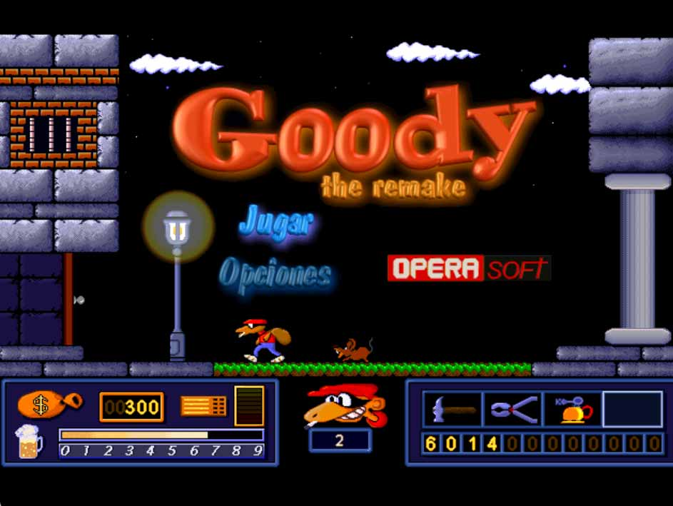

# Goody: The Remake — Dreamcast



**Dreamcast port by Alfonso M. González "Ryo Suzuki" — [SEGASaturno](https://www.segasaturno.com)**
· Non-commercial fan project / Proyecto de aficionados sin ánimo de lucro ([NOTICE](NOTICE.md))

**[English](#english) · [Español](#español)**

---

## English

A **SEGA Dreamcast** port of *Goody: The Remake*, the free remake that **Coptron Games** released in 2005
of **Opera Soft**'s classic *Goody* (1987, by Gonzalo Suárez).

It is the **first game ported with the BennuGD2 port for the Dreamcast** (KallistiOS) developed by
**Alfonso M. González "Ryo Suzuki" ([SEGASaturno](https://www.segasaturno.com))**. The BennuGD2 port will be released soon, with its full kit
(compiler, tools to convert graphics and sound, disc builder) and samples. This repository is its trial by
fire: a complete, real BennuGD2 game, with scrolling, collision maps, music, sound effects, menus and help
screens, running on the console. The game works.

> **Beta — testers wanted.** The game runs well in emulators, but it has not yet been tested in depth on
> real Dreamcast hardware. Everything seems to work, but there may still be issues we haven't found. If you
> play it, we'd love your feedback: open an issue with what you found (console or emulator, how you loaded
> it, and what happened). Every report helps make it better.

### Download

On the repository's **Releases** page:

- **GDI**: for emulators (Flycast, Redream...) and optical drive emulators (GDEMU, MODE, USB-GDROM).
- **CDI**: to burn to a CD-R and play on a real Dreamcast.

You don't need to build anything: download, unzip and play. The source code is here for anyone who wants
to see how it was done or rebuild it.

### Background

| | |
|---|---|
| Original | *Goody*, Opera Soft, 1987 (ZX Spectrum, Amstrad CPC, Amstrad PCW, MSX, MSX2, PC). Designed by Gonzalo "Gonzo" Suárez |
| Remake | *Goody: The Remake*, Coptron Games, May 2005, freeware, unofficial. Made with **Fenix** (compiled to `.dcb`) |
| Remake team | Programming and direction: José Javier Cárceles · Graphics: David Martínez Armesto and José Javier Cárceles · Music and sound: Álex Belencoso, Raúl Montón and José Javier Cárceles |
| BennuGD2 | The remake was adapted to **BennuGD2** (the successor of Fenix and BennuGD) by **SplinterGU** in 2011, and it ships in the official repository, under [`games/Goody`](https://github.com/SplinterGU/BennuGD2/tree/master/games/Goody) |
| This repository | That BennuGD2 version, ported to the Dreamcast |

Goody is a thief who must gather tools and money to crack the safe of the Bank of Spain. The remake keeps
the original's locations, puzzles and humour, with redrawn graphics and new music and sound.

### Controls

- A: throw bricks
- X: place or pick up the ladder
- Y or up: jump
- START: pause
- B: cancel
- D-pad or analog stick: move

### The problem: 47 MB for a 16 MB console

The Dreamcast has **16 MB of RAM, 8 MB of video RAM and 2 MB of sound RAM**. The game was made for PCs:

- BennuGD2's `games/Goody` folder is **47 MB**: 7.4 MB of graphics plus 39.8 MB of sound and video.
  The latter includes the Theora ending video (23 MB) and the 16-bit WAV music (about 16 MB).
- What counts is the **uncompressed** size, which is what ends up in memory:
  - each level FPG (`gnivel1..4`) is 6-7 MB;
  - the menu (`gmenu`) is 12 MB;
  - the logos are 26 MB (42 full-screen 640x480 frames);
  - the stage maps add up to 26.4 million pixels.
- The game loads whole FPGs with everything inside, which a PC doesn't notice. Here not even the menu
  would fit.

### What was done

**Result: the data goes from 47 MB to 11 MB and the disc image is 15 MB. Everything the stages need is in
RAM from boot, and the game never reads the disc again to change screens.**

#### Split data (`tools/prepare_assets.py`)

The FPGs are split into small files that keep **the same graphic codes**, so the game code barely changes:

| Original | Dreamcast |
|---|---|
| `gnivel1..4.gdg` (4 big FPGs) | `niv_00..31.fpg`: one per stage, holding only the maps that stage draws |
| collision maps inside the level FPGs | 8-bit `dur_NN.map`: 4 times smaller than 32-bit (`dur_a_map.py`) |
| `gmenu.gdg` (12 MB) | `gmenu.fpg` (1.7 MB), plus a minimal `gmenui.fpg` for use during play |
| 11 help pages inside the menu | one page per file, loaded when the page turns |
| credits inside the menu | `gcr*.fpg` and `gcrm*.fpg`, only while they are shown |
| `logos.gdg`, 42 full-screen frames | 3 frames, cropped to their content |
| almost empty 1920x320 object layers | cropped to their bounding box (stage 1: 3.3 → 2.1 MB of VRAM) |
| 16-bit WAV music (16 MB) | AICA ADPCM (4 MB), played by the sound chip with no CPU cost |
| Theora ending video (23 MB) | dropped: the game goes straight to the credits |

All FPGs are zlib-compressed: on a GD-ROM, reading less and decompressing is faster than reading more.

#### Everything in RAM (`dc_preload`)

At boot, behind the LOADING screen and before any sound plays, the game does:

```
dc_preload("data1/niv_*.fpg");     // 32 compressed stages: ~0.9 MB
dc_preload("data1/dur_*.map");     // 8-bit collision maps: ~0.3 MB
dc_preload("data1/gmenu*.fpg");    // menus
dc_preload("data1/*.glt");         // fonts
dc_preload("data2/musica1.gdt");   // stage music: plays from RAM
dc_preload("data1/gcr*.fpg");      // credits
```

`dc_preload` (from `libmod_dreamcast`, part of the BennuGD2 Dreamcast port) keeps the files in RAM
**exactly as they are on disc**: compressed, about 4.1 MB in total, in roughly 5 seconds. From then on
`fpg_load`, `map_load`, `sound_load`... on those paths read from RAM without the game changing. The result:

- stage changes take **100-200 ms**, with no loading screen;
- the music never cuts out, because nothing touches the disc while it plays;
- the 33 sound effects are loaded once at the start.

#### Video: the Dreamcast's PVR

These optimisations belong to the BennuGD2 port, so every game benefits from them:

- **Paletted textures.** Goody's graphics are 8-bit FPGs, so they go to VRAM as PAL8 textures, or PAL4 when
  they use 16 colours or fewer. That is 1 byte or half a byte per pixel instead of 2. Changing the palette
  only rewrites the palette, not the texture.
- **VQ textures.** The port also supports vector-quantised compressed textures (`.dtx`, made with the
  `dctex` tool). They are ideal for full-screen true-colour backgrounds: in the port's texture sample, a
  640x360 background takes 90 KB of VRAM and under 1 KB of RAM, against 904 KB of RAM as a JPG. Goody doesn't need them, since all its art is 8-bit and palettes
  are the better fit, but they are available.
- **Each polygon in the right PVR list.** Opaque polygons go to the OP list and on/off transparency goes to
  PT (punch-through). Only real translucency goes to TR, which is the expensive one. Per frame, Goody went
  from 41 polygons in TR to 3 in OP, 38 in PT and 0 in TR.
- **Twiddled textures,** which the PVR reads faster.
- **The interpreter is not the bottleneck:** during play Goody runs about 4,500 opcodes per frame, 8 % of
  the time. The game runs at the 25 FPS set by its own code.

#### Game fixes (`tools/patch_dc_*.py`)

Every change to the `.prg` is made by a script that stops if the original isn't what it expects:

- **Dreamcast controller** (see *Controls*).
- **Console menus:** no "Exit" and no "Window/Fullscreen". The scanlines are drawn with a stretched 8x480
  strip instead of a 640x480 image.
- **Sewer lift to stage 14:** Goody arrived 5 pixels from the limit and could fall back to stage 9 in a
  loop.
- **Help and menu credits,** which no longer showed after the FPGs were split.
- **8-bit collision maps:** the 32-bit PNG for stage 14 didn't fit in RAM, so Goody fell through the floor.

### Layout

```
goody-dc/juego/          the game (patched Goody.prg plus converted data1/, data2/)
goody-dc/tools/          prepare_assets.py, patch_*.py, dur_a_map.py, extraer_fpg.py...
original/                original gmenu.gdg and gmenu2.gdg (source of the credits)
g_build.sh               compiles with bgdc and builds the GDI
```

Building requires the BennuGD2 port for the Dreamcast (KallistiOS), which will be released later:

```
./g_build.sh                     # Goody.prg -> gdi/disc.gdi
```

The GDI runs in Flycast. It has not been tested on real Dreamcast hardware yet.

### Credits and licence

- *Goody* © 1987 Opera Soft. Designed by Gonzalo Suárez.
- *Goody: The Remake* © 2004–2006 Coptron Games: José Javier Cárceles, David Martínez Armesto, Álex Belencoso
  and Raúl Montón. Freeware.
- BennuGD2 adaptation: SplinterGU (2011), in the official [BennuGD2](https://github.com/SplinterGU/BennuGD2)
  repository.
- BennuGD2 port for the Dreamcast and this Goody port: Alfonso M. González "Ryo Suzuki"
  ([SEGASaturno](https://www.segasaturno.com)), developed with the help of Claude (Anthropic's AI) as a
  programming assistant.

A non-commercial fan project, made as a hobby, with no connection to Opera Soft, Coptron Games or SEGA. It
is free and must not be sold. The game's graphics, music and sound belong to their authors; only the code we
wrote is MIT ([LICENSE](LICENSE)). Full details in [NOTICE.md](NOTICE.md).

---

## Español

Port a **SEGA Dreamcast** de *Goody: The Remake*, el remake gratuito que **Coptron Games** publicó en 2005
del clásico *Goody* de **Opera Soft** (1987, de Gonzalo Suárez).

Es el **primer juego portado con el port de BennuGD2 para Dreamcast** (KallistiOS) desarrollado por
**Alfonso M. González "Ryo Suzuki" ([SEGASaturno](https://www.segasaturno.com))**. El port de BennuGD2 se publicará pronto, con todo su kit
(compilador, herramientas para convertir gráficos y sonido, creación del disco) y sus ejemplos. Este
repositorio sirve de prueba de fuego: un juego completo y real de BennuGD2, con scroll, colisiones por mapa de durezas, música, efectos,
menús y ayuda, corriendo en la consola. El juego funciona.

> **Beta — se buscan betatesters.** El juego funciona bien en emuladores, pero todavía no se ha probado a
> fondo en una Dreamcast real. Aparentemente todo va bien, aunque puede haber fallos que aún no hemos visto.
> Si lo juegas, agradeceremos mucho tus comentarios: abre una *issue* contando lo que hayas encontrado
> (consola o emulador, cómo lo cargaste y qué pasó). Cada aviso ayuda a mejorarlo.

### Descarga

En la página de **Releases** del repositorio:

- **GDI**: para emuladores (Flycast, Redream...) y emuladores de lector (GDEMU, MODE, USB-GDROM).
- **CDI**: para grabar en un CD-R y jugar en una Dreamcast real.

No hace falta compilar nada: descargar, descomprimir y jugar. El código está aquí para quien quiera ver cómo
se ha hecho o volver a montarlo.

### Historia del juego

| | |
|---|---|
| Original | *Goody*, Opera Soft, 1987 (ZX Spectrum, Amstrad CPC, Amstrad PCW, MSX, MSX2, PC). Idea y diseño de Gonzalo "Gonzo" Suárez |
| Remake | *Goody: The Remake*, Coptron Games, mayo de 2005, gratuito, no oficial. Hecho con **Fenix** (compilaba a `.dcb`) |
| Equipo del remake | Programación y dirección: José Javier Cárceles · Gráficos: David Martínez Armesto y José Javier Cárceles · Música y efectos: Álex Belencoso, Raúl Montón y José Javier Cárceles |
| BennuGD2 | **SplinterGU** adaptó el remake a **BennuGD2** (sucesor de Fenix y de BennuGD) en 2011, y está en su repositorio oficial, en [`games/Goody`](https://github.com/SplinterGU/BennuGD2/tree/master/games/Goody) |
| Este repositorio | Esa versión de BennuGD2, portada a la Dreamcast |

Goody es un ladrón que tiene que reunir herramientas y dinero para abrir la caja fuerte del Banco de España.
El remake conserva los escenarios, los puzles y el humor del original, con gráficos, música y efectos
rehechos.

### Controles

- A: lanzar ladrillos
- X: poner o recoger la escalera
- Y o arriba: saltar
- START: pausa
- B: cancelar
- Cruceta o stick analógico: moverse

### El problema: 47 MB para una consola con 16 MB

La Dreamcast tiene **16 MB de RAM, 8 MB de vídeo y 2 MB de sonido**. El juego estaba pensado para PC:

- La carpeta `games/Goody` de BennuGD2 pesa **47 MB**: 7,4 MB de gráficos y 39,8 MB de sonido y vídeo.
  Esto último incluye el vídeo final en Theora (23 MB) y la música en WAV de 16 bits (unos 16 MB).
- Lo que importa es el tamaño **descomprimido**, que es como queda en memoria:
  - cada FPG de nivel (`gnivel1..4`) son 6-7 MB;
  - el menú (`gmenu`), 12 MB;
  - los logos, 26 MB (42 fotogramas de 640x480);
  - los mapas de las fases suman 26,4 millones de píxeles.
- El juego carga FPG enteros con todo dentro y en PC no se nota. Aquí no cabría ni el menú.

### Lo que se ha hecho

**Resultado: los datos pasan de 47 MB a 11 MB y el disco ocupa 15 MB. Todo lo de las fases está en RAM
desde el arranque y el juego no vuelve a leer el disco para cambiar de pantalla.**

#### Datos troceados (`tools/prepare_assets.py`)

Los FPG se trocean en ficheros pequeños que conservan **los mismos códigos de gráfico**, así que el código
del juego casi no cambia:

| Original | Dreamcast |
|---|---|
| `gnivel1..4.gdg` (4 FPG grandes) | `niv_00..31.fpg`: uno por fase, solo con los mapas que esa fase dibuja |
| durezas dentro de los FPG de nivel | `dur_NN.map` de 8 bits: 4 veces menos que en 32 bits (`dur_a_map.py`) |
| `gmenu.gdg` (12 MB) | `gmenu.fpg` (1,7 MB), más un `gmenui.fpg` mínimo para dentro de la partida |
| 11 páginas de ayuda dentro del menú | una página por fichero, cargada al pasar página |
| créditos dentro del menú | `gcr*.fpg` y `gcrm*.fpg`, solo mientras se ven |
| `logos.gdg`, 42 fotogramas a pantalla completa | 3 fotogramas, recortados a su contenido |
| capas de objetos de 1920x320 casi vacías | recortadas a su caja (fase 1: de 3,3 a 2,1 MB de VRAM) |
| música WAV de 16 bits (16 MB) | ADPCM del AICA (4 MB), que reproduce el chip de sonido sin gastar CPU |
| vídeo final Theora (23 MB) | omitido: se pasa directamente a los créditos |

Todos los FPG van comprimidos con zlib: en un GD-ROM leer poco y descomprimir es más rápido que leer mucho.

#### Todo en RAM (`dc_preload`)

Al arrancar, con la pantalla de CARGANDO y antes de que suene nada, el juego hace:

```
dc_preload("data1/niv_*.fpg");     // 32 fases comprimidas: ~0,9 MB
dc_preload("data1/dur_*.map");     // durezas de 8 bits: ~0,3 MB
dc_preload("data1/gmenu*.fpg");    // menús
dc_preload("data1/*.glt");         // fuentes
dc_preload("data2/musica1.gdt");   // música de las fases: suena desde RAM
dc_preload("data1/gcr*.fpg");      // créditos
```

`dc_preload` (de `libmod_dreamcast`, parte del port de BennuGD2 para Dreamcast) guarda los ficheros en RAM
**tal como están en el disco**: comprimidos, unos 4,1 MB en total, en unos 5 segundos. A partir de ahí
`fpg_load`, `map_load`, `sound_load`... de esas rutas leen de la RAM sin que el juego cambie. Resultado:

- cambio de fase en **100-200 ms**, sin pantalla de carga;
- la música no se corta nunca, porque ya no hay accesos al disco mientras suena;
- los 33 efectos se cargan una vez al principio.

#### Vídeo: el PVR de la Dreamcast

Estas optimizaciones son del port de BennuGD2 y las aprovecha cualquier juego:

- **Texturas con paleta.** Los gráficos de Goody son FPG de 8 bits, así que van a la VRAM como texturas
  PAL8, o PAL4 si tienen 16 colores o menos. Eso es 1 byte o medio por píxel, en lugar de 2. Cambiar la
  paleta solo reescribe la paleta, no la textura.
- **Texturas VQ.** El port también admite texturas comprimidas por cuantización vectorial (`.dtx`,
  herramienta `dctex`). Son ideales para fondos a pantalla completa en color real: en el ejemplo de texturas
  del port, un fondo de 640x360 ocupa 90 KB de VRAM y menos de 1 KB de RAM, frente a 904 KB de RAM
  en JPG. Goody no las necesita porque todo su arte es de 8 bits y
  la paleta es mejor opción, pero están disponibles.
- **Cada cosa en su lista del PVR.** Lo opaco va a la lista OP y lo que tiene transparencia de todo o nada a
  la PT (punch-through). Solo lo semitransparente va a la TR, que es la cara. En Goody, por fotograma, se
  pasó de 41 polígonos en TR a 3 en OP, 38 en PT y 0 en TR.
- **Texturas en orden *twiddle*,** que el PVR lee más rápido.
- **El intérprete no es el cuello de botella:** en una fase, Goody ejecuta unos 4.500 opcodes por fotograma,
  el 8 % del tiempo. El juego va a los 25 FPS que fija su propio código.

#### Arreglos del juego (`tools/patch_dc_*.py`)

Cada cambio del `.prg` lo aplica un script que se para si el original no es el esperado:

- **Mando de Dreamcast** (ver *Controles*).
- **Menús de consola:** sin "Salir" ni "Pantalla ventana/completa". Las *scanlines* se hacen con una tira
  de 8x480 estirada en vez de una imagen de 640x480.
- **Ascensor de las cloacas a la fase 14:** Goody llegaba a 5 píxeles del límite y podía caer en bucle a la
  fase 9.
- **Ayuda y créditos del menú,** que no se veían tras trocear los FPG.
- **Durezas de 8 bits:** el PNG de 32 bits de la fase 14 no cabía en RAM y Goody atravesaba el suelo.

### Estructura

```
goody-dc/juego/          el juego (Goody.prg ya parcheado y data1/, data2/ convertidos)
goody-dc/tools/          prepare_assets.py, patch_*.py, dur_a_map.py, extraer_fpg.py...
original/                gmenu.gdg y gmenu2.gdg originales (fuente de los créditos)
g_build.sh               compila con bgdc y monta el GDI
```

Para compilar hace falta el port de BennuGD2 para Dreamcast (KallistiOS), que se publicará más adelante:

```
./g_build.sh                     # Goody.prg -> gdi/disc.gdi
```

El GDI funciona en Flycast. Falta probarlo en una Dreamcast real.

### Créditos y licencia

- *Goody* © 1987 Opera Soft. Idea y diseño de Gonzalo Suárez.
- *Goody: The Remake* © 2004–2006 Coptron Games: José Javier Cárceles, David Martínez Armesto, Álex Belencoso y
  Raúl Montón. Juego gratuito.
- Adaptación a BennuGD2: SplinterGU (2011), en el repositorio oficial de
  [BennuGD2](https://github.com/SplinterGU/BennuGD2).
- Port de BennuGD2 a Dreamcast y este port de Goody: Alfonso M. González "Ryo Suzuki"
  ([SEGASaturno](https://www.segasaturno.com)), desarrollado con la ayuda de Claude (la IA de Anthropic)
  como asistente de programación.

Proyecto de aficionados, hecho por hobby y sin ánimo de lucro, sin relación con Opera Soft, Coptron Games ni
SEGA. Es gratuito y no se puede vender. Los gráficos, la música y los efectos son de sus autores; solo el
código que hemos escrito va con licencia MIT ([LICENSE](LICENSE)). Todos los detalles en
[NOTICE.md](NOTICE.md).
